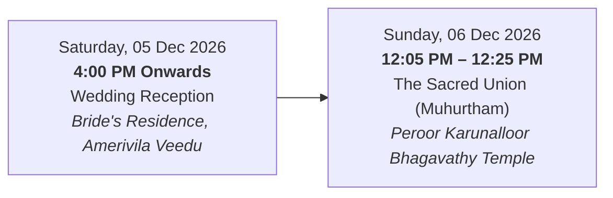

# Dr. Devika Rani & Vaisakhan — A Bespoke Kerala Wedding Experience

A digital wedding invitation website crafted for the bride's parents (**Sunil Kumar B & Preetha M**) celebrating the sacred marriage of **Dr. Devika Rani P.S.** and **Vaisakhan M.L.**

Designed as an heirloom artifact blending authentic Kerala temple heritage, Kasavu golden zari motifs, Nilavilakku craftsmanship, and modern editorial web design.

---

## 1. Wedding Details & Authoritative Schedule

### The Host Family
* **Bride's Parents**: Sunil Kumar B & Preetha M
* **Bride**: Dr. Devika Rani P.S.
* **Bride's Residence**: Amerivila Veedu, Thattarkonam P.O., Peroor, Kollam, Kerala (PIN: 691005)
* **Groom**: Vaisakhan M.L.
* **Groom's Parents**: Mohanan N & Late Lalithakumari K
* **Sharing the Happiness**: Nimisha Rani P.S.
* **Bride-side Contact Numbers**: `+91 96059 41066` & `+91 95265 16107`

---

### Sequence of Ceremonies

> **Important**: The celebratory reception is hosted on Saturday evening at the bride's residence **prior** to Sunday's sacred temple union.



#### Event 1: Pre-Ceremony Wedding Reception
* **Date**: Saturday, 05 December 2026
* **Time**: 4:00 PM onwards
* **Venue**: Bride's Residence (Amerivila Veedu, Thattarkonam P.O., Peroor, Kollam)
* **Google Maps Directions**: [Amerivila Veedu - Dr. Devika Rani](https://maps.app.goo.gl/tk4SToeGGwNHcAUZ7?g_st=aw)

#### Event 2: The Sacred Union (Wedding Ceremony)
* **Date**: Sunday, 06 December 2026
* **Muhurtham**: 12:05 PM – 12:25 PM (Asia/Kolkata)
* **Venue**: Peroor Karunalloor Bhagavathy Temple, Kollam
* **Verified Google Maps Link**: [Peroor Karunalloor Bhagavathy Temple](https://maps.app.goo.gl/63vEAnoGgeJPthKR8)

---

## 2. Visual Identity & Color Palette

| Token | Hex Value | Purpose |
|---|---|---|
| **Warm Ivory** | `#F8F4EC` | Canvas background & tactile handmade paper texture |
| **Deep Burgundy** | `#551F32` | Ceremonial typography, accents & hero styling |
| **Antique Gold** | `#B49360` | Kasavu borders, Nilavilakku brass tones, timestamps |
| **Forest Green** | `#35483D` | Auspicious foliage, Aalila motifs, natural harmony |
| **Charcoal** | `#252321` | High-legibility editorial text |
| **Muted Parchment** | `#EDE5D8` | Layered cards and framing panels |

---

## 3. Architecture & Features

```
devika-vaisakhan-wedding/
├── src/
│   ├── components/       # Nilavilakku, AalilaLeaf, Jasmine, AudioPlayer, Navigation
│   ├── sections/         # 7 Editorial Sections (Hero, Invite, Ceremony, Reception, Countdown, Blessings, Closing)
│   ├── hooks/            # useCountdown (Timezone-safe Asia/Kolkata), useWeddingData
│   ├── lib/              # RFC-compliant .ICS calendar generator, Web Share API
│   ├── data/             # Authoritative wedding data
│   ├── assets/           # Mandala texture & visual elements
│   └── styles/           # Tailwind CSS & custom Kasavu borders
├── public/               # Ambient Agam audio (bgm.mp3) & real couple portraits
├── api/                  # Standalone Vercel Serverless Functions (/api/wedding, /api/health)
├── vercel.json           # Vercel Vite routing & serverless configuration
├── vite.config.ts        # Vite build tool configuration
└── package.json          # Standalone React 18 + Vite dependencies
```
│   ├── src/
│   │   ├── routes/               # GET /api/health, GET /api/wedding
│   │   ├── middleware/           # Helmet, dynamic CORS, error handlers
│   │   ├── config/               # Environment configuration
│   │   └── server.ts             # Express server with graceful shutdown
│   ├── Dockerfile                # Multi-stage build + non-root runner
│   └── package.json
├── docker-compose.yml            # Local dev orchestration
├── render.yaml                   # Infrastructure-as-code for Render backend
├── .env.example
├── .gitignore
└── README.md
```

### Key Technical Highlights
1. **Dual-Mode Data Architecture**: Frontend queries `GET /api/wedding` but instantly defaults to local static data if the backend is down or unreachable. The site is 100% functional offline or as a pure static deployment.
2. **True Timezone Accuracy**: The countdown runs against `2026-12-06T12:05:00+05:30` (Asia/Kolkata), preventing hydration mismatch or timezone displacement for overseas guests.
3. **Calendar Integration**:
   * RFC-compliant downloadable `.ics` files with custom reminders.
   * Direct 1-click Google Calendar web event creation.
4. **Accessible Ambient Audio**: Classical instrumental background audio (`bgm.mp3`) with an unobtrusive floating audio toggle, equalizing soundwaves, and strict opt-in (no autoplay harassment).
5. **Auspicious Blessing Interaction**: Confetti petal shower with gold, burgundy, and ivory palette.

---

## 4. Local Development

```bash
npm install
npm run dev
```
* **Local Website**: `http://localhost:3000`
* **Production Build**: `npm run build`
* **Local Preview of Production Build**: `npm run preview`

---

## 5. Deployment Guides

### 1-Click Standalone Deployment to Vercel
1. Link your GitHub repository `devika-vaisakhan-wedding` to Vercel.
2. Vercel automatically detects:
   * **Framework Preset**: Vite
   * **Root Directory**: `./`
   * **Build Command**: `npm run build`
   * **Output Directory**: `dist`
3. Click **Deploy**. Done!
*(No multi-service configuration or subfolder selection required. The website runs 100% standalone on Vercel's global Edge CDN).*

---

## 6. Verification & Quality Assurance Checklist

- [x] Strict TypeScript compilation (`tsc --noEmit`)
- [x] Production build passes (`npm run build`)
- [x] Exact family details verified from bride's parents' perspective
- [x] Temple Google Maps URL verified (`https://maps.app.goo.gl/63vEAnoGgeJPthKR8`)
- [x] Residence Google Maps URL verified (`https://maps.app.goo.gl/tk4SToeGGwNHcAUZ7?g_st=aw`)
- [x] Reception date confirmed for Saturday, 05 Dec 2026 (prior to ceremony)
- [x] Responsive layout tested across mobile viewports (360px - 1440px)
- [x] Offline / standalone operation verified (zero backend dependency for core UX)
- [x] Web Share API with automatic clipboard fallback
- [x] RFC 5545 `.ics` calendar invitation generator tested
